# SSRI Manual Training — Investigation & Client Meeting Briefing

**Date:** 2026-11-02  
**Scope:** Read-only audit of the implemented Manual Training workflow  
**Status reminder:** RESEARCH READY — LIVE PIPELINE VERIFIED. Scientific validation = NOT_VALIDATED. Training completion ≠ scientific validation.

No application code was changed for this audit.

---

## How many “pages” are there?

There are **two separate Manual Training UIs** in the product. Do not present them as one wizard.

| Surface | Route | Audience | Auth | Format support | Steps |
|---------|-------|----------|------|----------------|-------|
| **Account Manual Training** | `/training` (+ `/training/[id]`, `/datasets`, `/models`) | Signed-in account users | Supabase Bearer → `/api/v1/platform/*` | Stage 2.5 ZIP **and** CSV / ZIP-of-CSVs | One page with phases + a run detail page |
| **Operator Manual Training** | `/training/operator` | Advanced operators | API key Bearer → `/api/v1/training/*` | Stage 2.5 ZIP only | Five in-page steps |

The account shell nav (`PlatformShell`) exposes: Dashboard, Datasets, Training, Models, Activity, Assessment. Operator training is **not** in that nav; it is a separate route.

Evidence: `frontend/components/platform/PlatformShell.tsx`, `frontend/app/training/page.tsx`, `frontend/app/training/operator/page.tsx`.

---

# Deliverable 1 — Manual Training page-by-page guide

## Path A — Account Manual Training (primary user-dashboard path)

### Page A1 — Manual training (`/training`)

#### A. Identity
- UI title: **Manual training**
- File: `frontend/app/training/page.tsx`
- Position: Entry point for account training. Phases on one page: idle → selected → uploading → validating → ready | failed → start run. History table below.

#### B. Purpose
The user names a dataset, chooses ZIP or CSV, uploads it, waits for validation, then starts a training run. SSRI stores the dataset under their account and queues Stage 2.5 training. A finished run stays `NOT_VALIDATED`.

#### C. Required uploads and inputs

| UI label | Mandatory? | What it is |
|----------|------------|------------|
| Dataset name | Yes (client-enforced) | Account label for the dataset |
| Dataset format | Yes | Radio: **Stage 2.5 ZIP** or **CSV** |
| CRS | Yes **if CSV** | e.g. `EPSG:32631`. Projected X/Y. |
| Description | No | Free text |
| Drop / choose file | Yes | `.zip` (Stage 2.5) or `.csv` / zip-of-CSVs when CSV selected |
| Training name | Yes once validated | Name for the queued run (default “Training run”) |

**ZIP (Stage 2.5) expected contents** (validated server-side):
- Root: `manifest.json`, `statistics.json`
- Non-empty `train/<id>/` and `validation/<id>/`
- Per sample: `feature_stack.npy` (13, H, W), `label.tif`, `metadata.json`
- Optional: `preview.png`, `test/`

**CSV expected contents** (converted then validated):
- X, Y projected coordinates
- All 13 SSRI feature columns (or a zip of named feature CSVs + labels)
- Hazard `label` column (0/1/2/-1 or names)
- User-supplied CRS
- Regular complete grid; max 250,000 rows; max upload 500 MB

A single X,Y,Z file is **feature-layer only** and fails as a supervised dataset.

Accept attributes: ZIP `accept=".zip,application/zip"`; CSV `accept=".csv,.zip,text/csv,application/zip"`.

#### D. Processing
1. `onUpload` → `platformPost("/datasets", {name, description})` → `POST /api/v1/platform/datasets`
2. `uploadDatasetVersionWithProgress` → `POST /api/v1/platform/datasets/{id}/versions` (multipart `file`, optional form `crs`)
3. Backend `register_dataset_zip` (`model/src/ssri_model/platform/service.py`):
   - CSV path → `convert_csv_dataset` → Stage 2.5 tree → `validate_training_dataset`
   - ZIP path → `ingest_zip_bytes` → extract (path-traversal blocked) → validate
4. Returns `DatasetVersion` with `validation_status`, errors, optional `preview.csv_analysis`
5. If `passed`, user submits `onStart` → `POST /api/v1/platform/training/runs` with dataset + version IDs
6. Job executor runs `execute_platform_training` → `run_manual_training` → `SSRIDataset` + `Trainer` + registry model record
7. History links to `/training/{run.id}`

#### E. Client-facing line
“This is where you give SSRI your own training package—either a prepared Stage 2.5 ZIP or a spatial CSV with all thirteen ground features plus hazard labels—and ask SSRI to learn a model from it. Validation only checks that the package matches the training format; it does not prove the labels are scientifically correct.”

#### F. Common mistakes
- Missing dataset name → client error
- CSV without CRS → client + server `CRS_REQUIRED`
- Single X,Y,Z → `FEATURE_LAYER_ONLY` / not trainable
- Missing feature channels or labels → validation failed
- Empty train or validation split → fail
- NaN/Inf in features → fail
- Irregular or incomplete grid → `CSV_GRID`
- Unrecognized CSV columns → `CSV_COLUMN`
- Screenshots / raw survey exports that are not Stage 2.5 → `UNSUPPORTED_UPLOAD`
- Wrong label codes outside 0/1/2/-1 → fail

---

### Page A2 — Training run detail (`/training/[id]`)

#### A. Identity
- UI: run name as title
- File: `frontend/app/training/[id]/page.tsx`
- Position: After a run is started from A1

#### B. Purpose
Poll run status every 3s. Show scientific status (`NOT_VALIDATED`), metrics JSON when present, cancel if still active.

#### C. Uploads
None. Inputs: Cancel button → `POST /api/v1/platform/training/runs/{id}/cancel`

#### D. Processing
`platformGet("/training/runs/{id}")` → Supabase/platform store. Metrics come from the completed Stage 2.5 trainer result.

#### E. Client line
“This screen is the progress ticket for the run you started. When it finishes, you get training metrics and a model version marked not scientifically validated.”

#### F. Mistakes
Users may read `COMPLETED` as “validated.” The UI still shows `scientific_validation_status`.

---

### Page A3 — Datasets list (`/datasets`) — supporting, not a wizard step

#### A. Identity
- Title: **Datasets**
- File: `frontend/app/datasets/page.tsx`
- Nav: Platform shell “Datasets”

#### B. Purpose
Create empty dataset records and list them. Upload happens on detail or on `/training`.

#### C. Inputs
Name (required), description (optional). No file upload here.

#### D. Processing
`POST /api/v1/platform/datasets`, `GET /api/v1/platform/datasets`

#### E. Client line
“Datasets are named containers for versions of your training files.”

---

### Page A4 — Dataset detail (`/datasets/[id]`)

#### A. Identity
- File: `frontend/app/datasets/[id]/page.tsx`

#### B. Purpose
Upload a new version (ZIP only in this UI) without replacing earlier versions; list validation status.

#### C. Uploads
Choose a `.zip` only (`accept=".zip"`). **No CSV picker and no CRS field on this page**, even though the same backend `register_dataset_zip` can convert CSV if called with CRS.

#### D. Processing
`uploadDatasetVersion` → `POST /api/v1/platform/datasets/{id}/versions`

#### E. Client line
“Each upload becomes a new version. Earlier versions stay on file.”

#### F. Gap
CSV training is available on `/training`, not on this detail page’s file picker.

---

### Page A5 — Models (`/models`)

#### A. Identity
- File: `frontend/app/models/page.tsx`

#### B. Purpose
List model versions created by completed account runs. Copy states that training success ≠ scientific validation and that promotion for assessment is via operator tools.

#### C. Uploads
None.

---

## Path B — Operator Manual Training (`/training/operator`)

Five in-page steps (not separate routes). File: `frontend/app/training/operator/page.tsx`. API: `frontend/lib/api.ts` → `/api/v1/training/*`.

### Step B1 — Create training dataset

- Inputs: name (required), description, geographic area, data source, notes, Stage 2.5 `.zip` only
- Button “Upload & validate”
- `createTrainingDataset` → `POST /api/v1/training/datasets`
- `uploadTrainingDatasetZip` → `POST /api/v1/training/datasets/{id}/upload`
- Backend: `ingest_zip_bytes` + immediate validation
- **No CSV** on this path

### Step B2 — Dataset preview

- Shows sample counts, splits, channels, spatial size, CRS, class distribution, errors/warnings
- Re-validate → `POST /api/v1/training/datasets/{id}/validate`
- Continue only if `validation_status === "passed"`

### Step B3 — Configure training

- Epochs (default 5), batch size (2), learning rate (0.001), seed (42), optional checkpoint name, device hardcoded `"cpu"` in the start call
- `startTrainingJob` → `POST /api/v1/training/jobs`

### Step B4 — Training progress

- Poll every 2s: `GET /api/v1/training/jobs/{jobId}`
- Shows phase, epoch, train/val loss, macro F1 from progress payload

### Step B5 — Training result

- Completion message + `scientific_validation_status` (always NOT_VALIDATED on accept)
- JSON result; “Start another run”
- Sidebar: requirements, trained models with **Promote for assessments** → `POST /api/v1/training/models/activate`

Client line: “This is the operator console for packaging a Stage 2.5 ZIP, checking it, configuring training knobs, watching the job, and optionally promoting a checkpoint path for assessments.”

---

# Deliverable 2 — Upload requirements matrix

| Step / surface | File or input | Required contents | Accepted format | Required CRS/metadata | Mandatory? | Purpose |
|----------------|---------------|-------------------|-----------------|------------------------|------------|---------|
| `/training` | Dataset name | Human label | text | — | Yes | Account record |
| `/training` | Format radio | zip or csv | UI choice | — | Yes | Selects parser |
| `/training` | CRS | EPSG:… or allowed id | text | Projected CRS for X/Y | Yes if CSV | Georeference reconstructed grids |
| `/training` | Description | Free text | text | — | No | Provenance note |
| `/training` | Stage 2.5 ZIP | manifest, statistics, train/, validation/, per-sample feature_stack.npy + label.tif + metadata.json | `.zip` ≤ 500 MB | CRS usually in manifest / label GeoTIFF | Yes for ZIP path | Ready-to-train Stage 2.5 dataset |
| `/training` | Trainable CSV | X, Y, all 13 features, label; regular full grid | `.csv` or zip of CSVs | CRS form field | Yes for CSV path | Converted into Stage 2.5 then trained |
| `/training` | Feature-only CSV | X,Y,Z or partial features | `.csv` | CRS | Accepted then **fails** trainable validation | Diagnosed as feature layer only |
| `/training` | Training name | Run label | text | — | Yes to start | Platform run record |
| `/datasets/[id]` | Version ZIP | Same Stage 2.5 contract | `.zip` | From package | Optional path | New version |
| `/training/operator` B1 | Dataset metadata | name + optional geo/source/notes | text | — | Name yes | Operator dataset record |
| `/training/operator` B1 | Dataset ZIP | Stage 2.5 only | `.zip` | In package | Yes | Operator ingest |
| `/training/operator` B3 | Epochs, batch, LR, seed, model name | Hyperparameters | numbers/text | — | Defaults exist | Configures `Trainer` |
| Neither path | Pretrained weights upload | — | — | — | **Not supported** in Manual Training UI | Fresh `SSRIModel` is created |
| Neither path | Raw FeatureStack acquisition | — | — | — | **Not part of Manual Training** | Live assess / research pipelines elsewhere |

### Concept map (do not conflate)

| Concept | Where it appears |
|---------|------------------|
| Environmental predictors | 13 channels in `feature_stack.npy` or CSV feature columns |
| Geographic coordinates / CRS | CSV X/Y + CRS; ZIP via GeoTIFF/manifest |
| Ground-truth labels | `label.tif` or CSV `label` → 0 subsidence, 1 landslide, 2 sinkhole, −1 nodata |
| Training / validation sets | Required non-empty splits; CSV auto-tiles into train/val |
| Test set | Optional in ZIP; CSV writer sets test empty |
| Model checkpoints | Produced by trainer (`best.pt`); promotion optional on operator UI |
| Hyperparameters | Operator step 3; account path hardcodes short run (see gaps) |
| Supplementary | preview.png recommended; geographic_area / data_source notes on operator |

### CSV / ZIP-CSV — verified rules

Source: `model/src/ssri_model/manual_training/csv_import.py`

- Supported on **platform** upload (`register_dataset_zip`), not on operator `/training` upload.
- Aliases for features (e.g. `wetness`→`twi`, `vegetation`→`ndvi`).
- Multi-file ZIP: one CSV per layer named after the feature; `label.csv` / `labels.csv` for labels; layers use X,Y,Z.
- Single multi-column CSV: X, Y, feature columns, optional label.
- Unrecognized columns → reject.
- Duplicate coordinates → reject.
- Missing grid cells → reject (no interpolation).
- Trainable only if **all 13** channels present **and** labels present.
- Tiles: prefer 16×16; minimum ~8×16 for train/val split.

Operator path: ZIP only (`ingest.py` `ALLOWED_ZIP_SUFFIXES = {".zip"}`).

---

# Deliverable 3 — End-to-end workflow diagram

```mermaid
flowchart TD
  subgraph account [Account path /training]
    U1[User names dataset + chooses ZIP or CSV]
    U2[POST /api/v1/platform/datasets]
    U3[POST .../datasets/id/versions]
    U4{CSV?}
    U5[convert_csv_dataset → Stage 2.5 tree]
    U6[ingest_zip_bytes extract]
    U7[validate_training_dataset]
    U8{passed?}
    U9[POST /api/v1/platform/training/runs]
    U10[JobExecutor → execute_platform_training]
    U11[run_manual_training → SSRIDataset + Trainer]
    U12[Platform model record NOT_VALIDATED]
    U13[Run detail /training/id]
    U1 --> U2 --> U3 --> U4
    U4 -->|yes| U5 --> U7
    U4 -->|no| U6 --> U7
    U7 --> U8
    U8 -->|no| Fail[Show validation errors]
    U8 -->|yes| U9 --> U10 --> U11 --> U12 --> U13
  end

  subgraph operator [Operator path /training/operator]
    O1[Create dataset metadata]
    O2[Upload Stage 2.5 ZIP]
    O3[Preview / re-validate]
    O4[Configure epochs batch LR seed]
    O5[POST /api/v1/training/jobs]
    O6[Poll job progress]
    O7[Result + optional Promote]
    O1 --> O2 --> O3 --> O4 --> O5 --> O6 --> O7
    O2 --> V[validate_training_dataset]
    O5 --> T[run_training_job → run_manual_training]
    O7 --> R[ModelRegistry activate]
  end
```

**Where training actually begins:** after validation passes and a job/run is accepted (`JobType.TRAINING`).

**Evaluation during Manual Training:** epoch validation loss / macro F1 from the Stage 2.5 `Trainer` on the validation split. This is **not** the separate scientific-validation programme.

**Final output:** checkpoint under training storage / registry (operator) or platform model record with checkpoint path (account). Scientific status remains `NOT_VALIDATED`.

---

# Deliverable 4 — Client meeting briefing

## A. Two-minute explanation

“Manual Training is how your team teaches SSRI from your own labelled ground data. You upload either a prepared Stage 2.5 ZIP—thirteen environmental layers stacked with matching hazard labels for train and validation tiles—or, on the account Training page, a spatial CSV that SSRI converts into that same package. SSRI checks the package for completeness and format, then runs the existing Stage 2.5 segmentation trainer for three mutually exclusive classes: subsidence, landslide, and sinkhole. When training finishes you get a checkpoint and metrics. That means the software finished learning from the files you supplied. It does **not** mean the model is scientifically validated, calibrated for your region, or ready for high-stakes decisions. Assessment on the map is a separate step and, for promoted operator checkpoints, still carries the research disclaimer.”

## B. Page-by-page talking points

### `/training`
- **Show:** format radios, drop zone, validation message, history.
- **Explain:** ZIP = ready ML tiles; CSV = tabular grid that must become those tiles.
- **Request:** Either a Stage 2.5 ZIP, or CSV with X/Y, CRS, 13 features, labels.
- **Ask:** Do you already have all thirteen layers aligned? Who labelled hazards? Same CRS everywhere?

### `/training/[id]`
- **Show:** status + scientific status.
- **Explain:** progress ticket; COMPLETED ≠ validated.
- **Ask:** Who will review metrics before any operational use?

### `/datasets` / `/datasets/[id]`
- **Show:** version history.
- **Explain:** containers and immutable versions; detail UI is ZIP-oriented.
- **Ask:** Will versions track inventory updates over time?

### `/models`
- **Show:** version list and NOT_VALIDATED.
- **Explain:** artifacts from runs; promotion for assess is operator-side.

### `/training/operator` (if showing advanced path)
- **Show:** five steps + promote.
- **Explain:** ZIP-only, configurable epochs, explicit promotion.
- **Ask:** Who holds the API key / operator role?

## C. Questions to ask the client

**Business / use**
- Which geography will you train on, and where do you intend to assess afterward?
- Is this screening, research, or a regulated decision pathway?

**Environmental data** *(GIS / geospatial specialist)*
- Do you have rasters or tables for all 13 channels in SSRI order?
- Resolution, CRS, extent, nodata convention (−9999 for features)?
- Are layers already co-registered on one grid?

**Labels** *(geologist / hazard specialist)*
- How are subsidence, landslide, and sinkhole defined and sourced?
- Presence-only inventory or full classified maps? Nodata policy?
- Are labels pixel-aligned to the feature grid?

**Sample size / splits** *(data scientist)*
- Enough tiles for non-empty train and validation?
- Spatial separation between train and validation to limit leakage?
- Any held-out test region?

**Operations**
- Prefer account CSV/ZIP UI or operator ZIP console?
- Who may promote a checkpoint into assessment?

## D. Likely questions and accurate answers

| Question | Answer from the code |
|----------|----------------------|
| Why these files? | The Stage 2.5 trainer needs 13-channel stacks and per-pixel class labels in a fixed layout. |
| Can we upload our own geospatial data? | Yes, if packaged as Stage 2.5 ZIP or a complete trainable CSV on the account Training page. Arbitrary rasters/screenshots are rejected. |
| CSV instead of rasters? | Yes on `/training` (platform). Operator path is ZIP-only. CSV must be a regular grid with CRS, all 13 features, and labels. |
| No hazard labels? | You cannot supervise this model. Feature-only CSV is diagnosed as not trainable. SSRI does not invent labels. |
| Auto-generate labels? | No in Manual Training. |
| How do we know accuracy? | Trainer metrics (e.g. validation loss, macro F1 on operator progress) are software metrics. Scientific gates / field validation are separate and currently incomplete. |
| What is the final output? | A checkpoint + metrics + record marked NOT_VALIDATED. Operator can promote a path for assessments. |
| Use in another region? | The software can load a checkpoint elsewhere, but transfer performance is unproven without target validation. African transfer is documented as not measured. |

---

# Deliverable 5 — Client data-readiness checklist

### Must prepare (application-enforced for a trainable run)
- [ ] Non-empty **train** and **validation** samples (ZIP) **or** a CSV grid large enough to split (≥ ~8×16 cells)
- [ ] All **13** feature channels in SSRI names/order (or convertible aliases)
- [ ] **Labels** for every grid cell used in training: 0 subsidence, 1 landslide, 2 sinkhole, or −1 nodata
- [ ] For CSV: explicit **CRS** (e.g. EPSG:32631), UTF-8, header row, finite numbers, complete regular grid
- [ ] For ZIP: `manifest.json`, `statistics.json`, per-sample `feature_stack.npy`, `label.tif`, `metadata.json`
- [ ] Upload under **500 MB**

### SSRI can generate / derive
- [ ] From trainable CSV: Stage 2.5 tree, tiles, `statistics.json`, `manifest.json`, label GeoTIFFs
- [ ] From training: checkpoint, run metrics, platform/operator model records

### Optional
- [ ] `preview.png` per sample
- [ ] `test/` split
- [ ] Dataset description / geographic area / data source notes
- [ ] Operator hyperparameters (epochs, LR, …)

### Obtain from specialists
- [ ] GIS: co-registration, CRS, resolution, nodata
- [ ] Geology: hazard class definitions and inventory provenance
- [ ] Data science: spatial split strategy and evaluation plan

### If they have features but no labels
Manual Training will not produce a defensible supervised hazard classifier. Feature-only CSV fails trainable validation.

### If they have inventories but no features
They must still build or acquire the 13 environmental layers on the same grid. Manual Training does **not** call live FeatureStack acquisition for them.

### Scientific recommendation (not all enforced by the app)
Representative coverage of all three classes, spatial independence of validation, documented label provenance, and a separate human scientific-validation process before any operational claim.

---

# Deliverable 6 — Technical findings and gaps

### Relationship to the ML pipeline

| Component | Invoked by Manual Training? |
|-----------|----------------------------|
| FeatureStack / live EO acquisition | **No** — user supplies stacks or CSV |
| DatasetBuilder (research) | **No** — CSV converter writes Stage 2.5 layout directly |
| `SSRIDataset` | **Yes** — `run_manual_training` |
| `SSRIModel` + `Trainer` | **Yes** |
| Evaluator / scientific validation programme | **Not** as Stage 2.9 gates; only trainer validation metrics |
| Inference / assess | **Indirect** — only after operator **promote**; account Models page does not promote |
| Fixture / demo assessment | Separate from Manual Training |

### Implementation gaps / discrepancies

1. **Two UIs, different contracts.** Account `/training` supports CSV; operator `/training/operator` and `/datasets/[id]` UI are ZIP-oriented. Easy to mis-brief the client as “always ZIP” or “always CSV.”

2. **Account training epochs hardcoded to 1.** `execute_platform_training` calls `run_manual_training(..., epochs=1, batch_size=2, ...)` even though `start_run` stores payload `epochs: 5`. Operator UI exposes configurable epochs. Evidence: `model/src/ssri_model/platform/service.py` (~175–186) vs `platform.py` payload (~343–348).

3. **Promotion path.** Operator sidebar can activate registry models for assessments. Account `/models` explicitly says promotion is via operator tools—account completion does not wire the dashboard checkpoint by itself.

4. **Auth split.** Account path = Supabase session. Operator path = API key (`require_run_inference`). Dashboard assess still uses API key, not the user session.

5. **Docs vs UI.** `docs/operations.md` correctly notes platform CSV conversion. `docs/VERSION_4.md` emphasizes Stage 2.5 ZIP; still accurate as the canonical layout after conversion.

6. **No pretrained weight upload** in Manual Training; always `create_ssri_model(SSRIModelConfig())`.

7. **Scientific status** is forced to `NOT_VALIDATED` on job create and completion. Correct product posture; must be said aloud in the meeting.

8. **Flaky poll timing** (prior audit): account/operator training jobs are async; long runs can stress client poll budgets in tests—not a client briefing item unless demos hang.

### Safeguards for the meeting
- Do not call a completed Manual Training run scientifically validated.
- Do not equate Lagos fixture assess success with a client-trained model.
- Do not invent accuracy numbers.
- Keep classes as **subsidence / landslide / sinkhole** (not liquefaction).
- Do not claim FeatureStack auto-builds training data inside this workflow.

### Evidence index (high-signal)

| Claim | Evidence |
|-------|----------|
| Account Manual Training page | `frontend/app/training/page.tsx` |
| Operator 5 steps | `frontend/app/training/operator/page.tsx` (`Step` union) |
| Platform upload + CSV | `platform/service.py` `register_dataset_zip`, `_register_csv` |
| Operator ZIP ingest | `manual_training/ingest.py` `ingest_zip_bytes` |
| Validation rules | `manual_training/validation.py` `validate_training_dataset` |
| CSV schema | `manual_training/csv_import.py` |
| Trainer entry | `manual_training/runner.py` `run_manual_training` |
| Operator API | `api/routes/training.py` |
| Platform API | `api/routes/platform.py` |
| Channel names | `ml/constants.py` / training requirements endpoint |

---

## Concise status for the meeting lead

Manual Training is implemented as an account single-page upload→validate→train flow (ZIP + CSV) plus a separate five-step operator ZIP console. Both ultimately train `SSRIModel` via `Trainer` on Stage 2.5 data. Neither validates science. CSV without full features and labels cannot train. Live FeatureStack is not part of this workflow. Prefer the account path for client demos of CSV; prefer operator for ZIP packaging, hyperparameter control, and checkpoint promotion.
